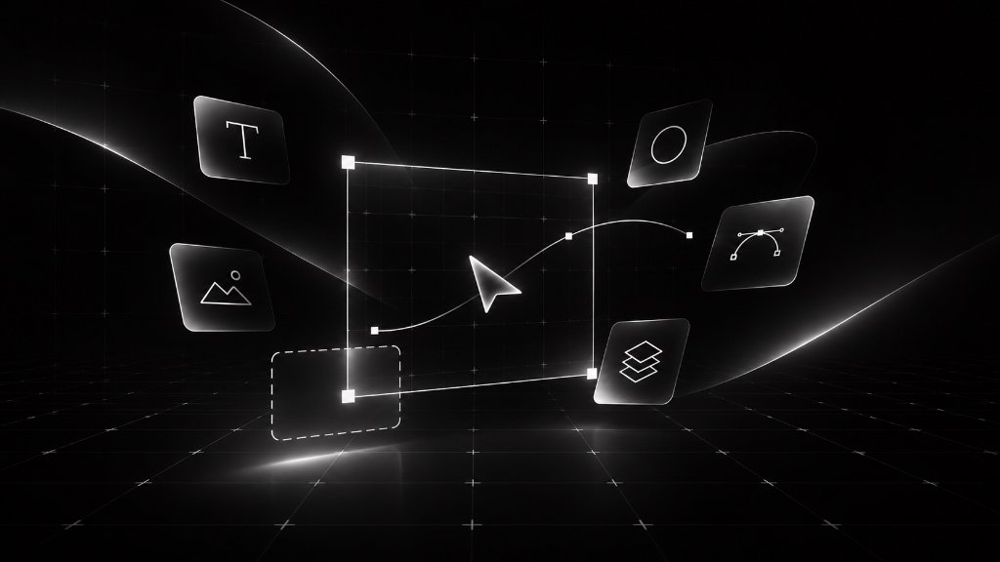

<p align="center">
  
</p>

<p align="center">
  <a href="https://www.npmjs.com/package/figma-canvas-mcp"></a>
  <a href="https://github.com/nicktofal/figma-canvas-mcp"></a>
  <a href="LICENSE"></a>
  <a href="https://modelcontextprotocol.io"></a>
  <a href="https://nodejs.org"></a>
</p>

<h1 align="center">Figma Canvas MCP</h1>

<p align="center">
  <b>The open, full-access Canvas engine for AI agents in Figma.</b><br>
  Turn Claude Code, Cursor, Windsurf, or any MCP client into an autonomous Figma designer.<br>
  Direct access to native Auto Layout, CSS Grid, motion timelines, WebGL shaders, and atomic JS execution — <b>zero paid seats required</b>.
</p>

---

## ⚡ Why Figma Canvas MCP?

Most open-source Figma bridges expose 20–40 fragile, granular tools (`create_rect`, `set_fill`, `set_padding`) and fall over the moment you need strokes, token variables, or real Auto Layout. To draw one card, an agent makes 30+ sequential calls, burns thousands of context tokens, and leaves half-broken layouts.

**Figma Canvas MCP takes a completely different architectural approach:**

```
AI Agent (Cursor / Claude / Windsurf)
   │
   ▼  stdio (JSON-RPC)
Figma Canvas MCP Server (Node.js)
   │
   ▼  WebSocket (127.0.0.1:3055)
Figma Plugin (ui.html DOM Runner ⇄ code.js Main Thread)
   │
   ▼  Direct Canvas Access
Figma Document (Native Auto Layout, GRID, Motion & Tokens)
```

### The 4 Core Superpowers:

1. **Declarative `render_html` (DOM → Native Layers):**
   * **Flexbox → Native Auto Layout**: gap, padding, stretch, fill/hug, wrap.
   * **CSS Grid → Native Figma GRID (`layoutMode = 'GRID'`)**: fr/px/auto tracks, spans, cell alignment. *(First open-source bridge to support Figma's native Grid API!)*
   * **18 Blend Modes**: at node, paint, and effect levels.
   * **Vector Masks**: `clip-path` shapes → native masks.
   * **Components & Tokens**: `data-figma-component` → components + instances; `bindVariables` → auto-bind colors, radii, and typography to local file variables.

2. **Atomic JS REPL (`execute`) with Transactional Undo (`history`):**
   * Runs arbitrary JavaScript inside the Figma Plugin sandbox (`AsyncFunction`) with full access to `figma.*`, data input via `args`, and helper utilities `h`.
   * **Transactional Safety**: Every command is executed within a sentinel-guarded transaction. If the code throws, **all mutations are rolled back automatically**. The sentinel guard ensures the bridge **never undoes manual human edits**.

3. **Native Motion & Video Engine (`motion` + `capture_animation`):**
   * Access to Figma's **native motion timeline**: keyframe tracks (opacity, position, scale, rotation, radius, stroke, effects, path trim).
   * 7 built-in animation presets (`TextStagger`, `Position`, `Scale`, `Rotation`, `Size`, `Opacity`, `Path`).
   * **Native Video Export**: Export timeline animations straight to MP4, GIF, or WEBM on disk via bundled `ffmpeg`.

4. **Visual Regression Loop (`compare`):**
   * Pixel-by-pixel diffing of canvas nodes against another node, local PNG file, or external URL.
   * Returns exact mismatch ratio, heatmap hotspots, and a diff overlay image — allowing multimodal models to self-correct layout flaws in a single turn.

---

## 📊 Comparison: How it stacks up

| Feature | Official Figma MCP | Conventional Bridges (`TalkToFigma`) | `html.to.design` | **Figma Canvas MCP** |
| :--- | :---: | :---: | :---: | :---: |
| **Pricing** | Paid Seat (Dev/Full) + usage-based | Free / Local | Paid Subscription | **100% Free & Open Source** |
| **Canvas Writing** | Limited Beta / Cloud only | RPC wrappers (`create_rect`) | HTML import only | **Full Plugin API (`figma.*`)** |
| **Native CSS Grid** | ❌ | ❌ (Absolute fallback) | ⚠️ Partial | **✅ Native `layoutMode = 'GRID'`** |
| **Tailwind to Auto Layout** | ❌ | ❌ | ✅ | **✅ Full fidelity + token bindings** |
| **Transactional Rollback** | ❌ | ❌ (leaves broken frames) | ❌ | **✅ Atomic safe rollback on error** |
| **Motion Timelines & Video** | ❌ | ❌ | ❌ | **✅ Keyframes + MP4/GIF export** |
| **WebGL GLSL Shaders** | ❌ | ❌ | ❌ | **✅ Procedural noise & textures** |
| **Visual Diff / Self-Correction** | ❌ | ❌ | ❌ | **✅ Built-in `compare` tool** |
| **Round-Trip (Canvas → Code)** | ✅ Dev Mode | ❌ | ❌ | **✅ `to_code` (HTML / React JSX)** |

---

## 🚀 Quickstart

### Prerequisites
* **Node.js ≥ 18**
* **Figma Desktop App** (or Figma in Chrome)

---

### Step 1: Register in your AI Client (One-Liner)

#### Claude Code (CLI)
```bash
claude mcp add figma-canvas-mcp -- npx -y figma-canvas-mcp
```

#### Cursor (`~/.cursor/mcp.json`)
```json
{
  "mcpServers": {
    "figma-canvas": {
      "command": "npx",
      "args": ["-y", "figma-canvas-mcp"]
    }
  }
}
```

#### Windsurf / Claude Desktop (`mcp.json`)
```json
{
  "mcpServers": {
    "figma-canvas": {
      "command": "npx",
      "args": ["-y", "figma-canvas-mcp"]
    }
  }
}
```

#### OpenCode (`opencode.json`)
```json
{
  "$schema": "https://opencode.ai/config.json",
  "mcp": {
    "figma-canvas": {
      "type": "local",
      "command": ["npx", "-y", "figma-canvas-mcp"],
      "enabled": true
    }
  }
}
```

---

### Step 2: Load the Companion Plugin (Once)

1. Clone this repository: `git clone https://github.com/nicktofal/figma-canvas-mcp.git`
2. In Figma Desktop: *Plugins → Development → Import plugin from manifest…*
3. Select `plugin/manifest.json`.

*(Soon available via 1-click install in Figma Community!)*

---

### Step 3: Use it!

1. Open any Figma document and run *Plugins → Development → Figma Canvas MCP*.
2. Leave the small bridge window open (it connects automatically).
3. In Claude Code, Cursor, or Windsurf, prompt your agent:

> *"Build a modern dark-mode pricing page with three glassmorphic cards, Auto Layout, and bind all colors to file variables."*
>
> *"Animate this button with a staggered entrance and export an MP4 to my assets folder."*
>
> *"Compare the generated header against the reference screenshot in assets/mockup.png and fix any spacing errors."*

---

## 🛠️ Complete Tool Reference

| Tool | Description |
| :--- | :--- |
| **`render_html`** | Convert HTML/CSS/Tailwind into native Figma Auto Layout and GRID frames. |
| **`execute`** | Run arbitrary JavaScript with full `figma.*` access, helper methods `h`, and parameterized `args`. |
| **`history`** | Safe transactional undo (`undo {steps}`) with sentinel guards; save named version checkpoints. |
| **`motion`** | Manage Figma's native motion timeline (apply keyframe tracks, set durations, animation presets). |
| **`capture_animation`** | Render offline animation frames to MP4, GIF, or WEBM using bundled ffmpeg. |
| **`export`** | Export canvas nodes to disk in PNG (up to 8000px), SVG, PDF, REST JSON, or native MP4/GIF. |
| **`compare`** | Pixel diff of a node against another node, PNG file, or URL with mismatch ratio & heatmap. |
| **`to_code`** | Reverse bridge: extract clean HTML/CSS or React JSX from selected Figma nodes. |
| **`insert_asset`** | Place SVGs, Iconify icons (`lucide:arrow-right`), high-res images, and video fills. |
| **`render_shader`** | Render procedural GLSL fragment shaders in offscreen WebGL and apply as image fills. |
| **`prototype`** | Setup interactive flows, click/hover interactions, Smart Animate transitions, and overlays. |
| **`screenshot`** | Capture high-resolution PNG screenshots of nodes or the active selection. |
| **`read`** | Compact JSON tree inspection of nodes, selection, page, or document inventory. |
| **`page`** | Inspect, switch, and create pages. |
| **`library`** | Discover and import components, styles, and variables from team libraries. |
| **`figma_rest`** | Optional fallback to Figma Cloud REST API using `FIGMA_TOKEN`. |
| **`skills`** | Built-in design guidelines and anti-slop rulesets (`core`, `design-taste`, `layout`, etc.). |
| **`status`** | Connection check, active file detection, and multi-file target switching (`status {use: "File"}`). |

---

## 🔒 Security & Local Loopback

* **Strict Loopback Binding**: The WebSocket relay binds exclusively to local loopback interfaces (`127.0.0.1` and `::1`).
* **Origin Verification**: Incoming connections with browser origins are rejected (only the Figma plugin sandbox with origin `null` is accepted).
* **Sandboxed Execution**: Code runs strictly within Figma's plugin security sandbox.

---

## 🏗️ Project Architecture

```
figma-canvas-mcp/
├── assets/             # Brand logos, icons, and hero banners
├── plugin/             # Figma plugin
│   ├── manifest.json   # Plugin manifest & permissions
│   ├── code.js         # Canvas main-thread execution & native builders
│   └── ui.html         # WebSocket relay, DOM layout parser, WebGL shader runner
└── server/             # TypeScript MCP Server
    ├── src/
    │   ├── index.ts    # MCP server tool definitions
    │   ├── bridge.ts   # Local WebSocket bridge
    │   └── media.ts    # ffmpeg animation encoder
    └── skills/         # Built-in design guidelines and recipes
```

---

## 📄 License

MIT © 2026. Free for personal and commercial use.
